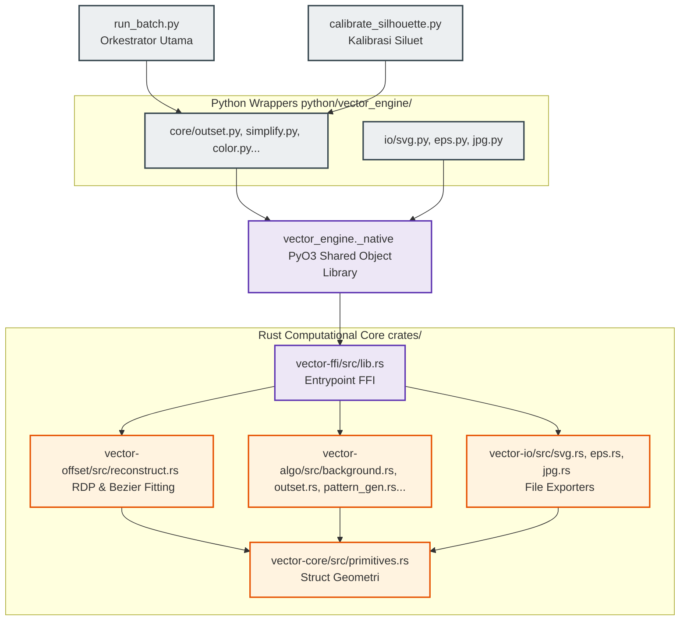

# Vector Geometry Engine

A modular, high-performance **Vector Geometry Engine** written in **Rust** with high-level **Python** orchestration bindings and a standalone **CLI** application.

## Project Architecture

The codebase is organized as a Cargo Workspace (Rust computational core) combined with a Python package (Orchestration & Workflow engine):

- **`crates/vector-core`**: Core math, geometric primitives, traits, and domain error taxonomy.
- **`crates/vector-algo`**: Computational geometry algorithms (intersections, clipping, boolean union, simplification, canvas scaling).
- **`crates/vector-spatial`**: Fast spatial indexing structures (R*-Tree, BVH).
- **`crates/vector-io`**: Serialization & export formats (WKT, WKB, GeoJSON, SVG, EPS, JPG Preview).
- **`crates/vector-ffi`**: PyO3 cross-language bindings and logging subscriber bridge.
- **`crates/vector-cli`**: High-performance command line binary application.
- **`python/vector_engine`**: Python API, configuration system, structlog integration, and workflow DAG runner.

### ⏱️ Workflow & System Diagram (Alur Kerja)

Diagram berikut menggambarkan bagaimana file Python (sebagai pengatur/mandor) memanggil modul jembatan PyO3 untuk mengeksekusi perhitungan geometri berat di dalam Core Engine Rust:



### Alur Fase Pemrosesan (Phase 0 s.d. 7)

| Fase | Nama Fase | Tipe Teknologi | Berkas yang Berperan Utama |
| :---: | :--- | :---: | :--- |
| **0** | **Initialization** | **Python 🐍** | `run_batch.py` |
| **1** | **Outset & Combine** | **Hybrid ⚖️** | `crates/vector-algo/src/background.rs` & `color_combine.rs` |
| **2** | **Simplification** | **Rust 🦀** | `crates/vector-offset/src/reconstruct.rs` |
| **3** | **Color Isolation & Silhouette** | **Hybrid ⚖️** | `crates/vector-algo/src/luminance.rs` & `color.rs` |
| **4** | **Bad Board Generation** | **Hybrid ⚖️** | `crates/vector-algo/src/duo_board.rs` |
| **5** | **Seamless Pattern** | **Hybrid ⚖️** | `crates/vector-algo/src/pattern_gen.rs` & `pattern_detect.rs` |
| **6** | **Canvas Auto-Scale** | **Hybrid ⚖️** | `crates/vector-algo/src/scale.rs` |
| **7** | **Disk Export & JPG Render** | **Hybrid ⚖️** | `crates/vector-io/src/eps.rs` & `jpg.rs` |

---

## Features & Capabilities

- **Robust SVG Parser**: Accepts standard SVG files exported from Adobe Illustrator, Inkscape, Affinity Designer, and Sketch. Includes automated XML DOCTYPE/DTD pre-processing to safely neutralize XXE attack vectors while preserving 100% of graphic elements, geometry, and styling metadata.
- **Polygon Union & Boolean Geometry**: High-precision polygon clipping, bounding box rejection, ray-casting point-in-polygon tests, and SVG path data union (`union_svg_d_strings`).
- **Path Simplification**: Ramer-Douglas-Peucker (RDP) shape-preserving vertex reduction with configurable tolerance.
- **Canvas Scaling**: Uniform bounding box geometry scaler operating only when canvas dimensions fall below target thresholds.
- **Seamless Pattern Analyzer & Generator**: 0-100 mathematical pattern suitability score detector and gated tile grid generator preserving original color fills and strokes.
- **Color & Luminance Variant Engines**: Custom HEX palettes, preset palettes (`pastel`, `cyberpunk`, `monochrome`, `earth`), and bi-directional HSL luminance scaling.
- **Export Formats**: PostScript 3.0 EPS serializer (AI / Inkscape DSC compliant) and scanline JPEG preview rendering.

---

## Building and Installation


### Prerequisites
- Rust (Cargo) 1.70+
- Python 3.9+
- [`maturin`](https://github.com/PyO3/maturin)

### Build Executable CLI Binary
```bash
# Build release binary
cargo build --release

# Binary executable path:
./target/release/vector-cli --help
```

### Development Setup (Python Package)
```bash
# Create and activate virtual environment
python -m venv .venv
source .venv/bin/activate

# Build and install in editable mode with maturin
pip install maturin
maturin develop
```

---

## CLI Usage Instructions (`vector-cli`)

The `vector-cli` binary batch-processes SVG vector graphics, parses geometry, outputs detailed statistics, and exports processed files.

### Basic Batch Processing
```bash
vector-cli --input ./input_svgs --output ./output_svgs
```

### CLI Options

| Argument | Short | Description | Example |
| :--- | :---: | :--- | :--- |
| `--input` | `-i` | Input directory containing SVG files (or path to a single `.svg` file). | `-i ./input_svgs` |
| `--output` | `-o` | Output directory where processed SVG files will be saved. | `-o ./output_svgs` |
| `--config` | `-c` | Optional path to custom configuration YAML file. | `-c ./config/default_config.yaml` |
| `--threads` | `-t` | Worker threadpool size for parallel Rayon processing (`0` = auto-detect). | `-t 8` |
| `--verbose` | `-v` | Enable verbose debug logging output. | `-v` |

### Usage Examples

1. **Process a single SVG file with verbose logging**:
   ```bash
   vector-cli --input ./sample.svg --output ./output_dir --verbose
   ```

2. **Batch process an SVG folder using 8 worker threads**:
   ```bash
   vector-cli -i ./graphics/svgs -o ./graphics/processed -t 8
   ```

3. **Batch process using custom YAML configuration**:
   ```bash
   vector-cli -i ./input_dir -o ./output_dir -c ./config/my_config.yaml -v
   ```

---

## License
Licensed under either of Apache License, Version 2.0 or MIT license at your option.
