# Vector Geometry Engine

A modular, high-performance **Vector Geometry Engine** written in **Rust** with high-level **Python** orchestration bindings and a standalone **CLI** application.

## Project Architecture

The codebase is organized as a Cargo Workspace (Rust computational core) combined with a Python package (Orchestration & Workflow engine):

- **`crates/vector-core`**: Core math, geometric primitives, traits, and domain error taxonomy.
- **`crates/vector-algo`**: Computational geometry algorithms (intersections, clipping, boolean union, simplification, canvas scaling, 11 seamless pattern styles).
- **`crates/vector-spatial`**: Fast spatial indexing structures (R*-Tree, BVH).
- **`crates/vector-io`**: Serialization & export formats (WKT, WKB, GeoJSON, SVG, EPS, JPG Preview).
- **`crates/vector-ffi`**: PyO3 cross-language bindings and logging subscriber bridge.
- **`crates/vector-cli`**: High-performance command line binary application.
- **`python/vector_engine`**: Python API, configuration system, structlog integration, and workflow DAG runner.
- **`server/web_server.py`**: Integrated 5-Node ComfyUI Web Dashboard server (`http://localhost:8000`).
- **`scripts/remixer_engine.js`**: Node 0 AI Concept Remixer Pro Puppeteer automation.
- **`scripts/metadata_engine.js`**: Node 4 AI Metadata Generator & ExifTool Injector engine.

### ⏱️ Workflow & System Diagram (5-Node ComfyUI Graph Pipeline)

Diagram berikut menggambarkan arsitektur grafis 5-Node otomatisasi **Vector Engine**:

```mermaid
graph LR
    %% Style Definitions
    classDef node0 fill:#0f172a,stroke:#ec4899,stroke-width:2px;
    classDef node1 fill:#0f172a,stroke:#c084fc,stroke-width:2px;
    classDef node2 fill:#0f172a,stroke:#38bdf8,stroke-width:2px;
    classDef node3 fill:#0f172a,stroke:#4ade80,stroke-width:2px;
    classDef node4 fill:#0f172a,stroke:#f59e0b,stroke-width:2px;

    N0["🎨 NODE 0: AI REMIXER PRO <br> Local Image / HTTP ➔ Gemini Canvas JPG"]:::node0
    N1["🔑 NODE 1: CHROMIUM AUTH <br> User Profile Auth & Session"]:::node1
    N2["🖼️ NODE 2: VECTORIZER HEADLESS <br> Raster PNG/JPG ➔ SVG"]:::node2
    N3["⚡ NODE 3: RUST VECTOR ENGINE <br> Phase 1-7 Geometry & 11 Patterns"]:::node3
    N4["🏷️ NODE 4: AI METADATA & EXIFTOOL <br> Gemini AI ➔ ExifTool Injected EPS/JPG"]:::node4

    N0 --> N1
    N1 --> N2
    N2 --> N3
    N3 --> N4
```



### Alur Fase Pemrosesan (Node 0 s.d. Node 4 & Phase 0-7 Geometry)

| Fase / Node | Nama Komponen | Tipe Teknologi | Berkas Utama | Detail Fitur |
| :---: | :--- | :---: | :--- | :--- |
| **Node 0** | **AI Concept Remixer Pro** | **Puppeteer / Gemini Canvas** | `scripts/remixer_engine.js` | Mengolah gambar lokal/URL HTTP (Pinterest) via Gemini AI Canvas, membedah gaya visual, dan menghasilkan stok JPG di `input/`. |
| **Node 1** | **Chromium Auth** | **Node.js / Chromium** | `server/web_server.py` | Mengelola sesi login terautentikasi pengguna secara konsisten. |
| **Node 2** | **Vectorizer Headless** | **Puppeteer Stealth** | `scripts/vectorizer_headless.js` | Mengonversi gambar raster ke SVG via Vectorizer.ai secara otomatis. |
| **Node 3 (Phase 0-7)** | **Rust Geometry Engine** | **Rust 🦀 / Python** | `crates/vector-cli`, `run_batch.py` | Transform Baking, RDP Curve Fitting, HSL Color Isolator, 3-Panel Board, dan 11 Seamless Pattern Styles. |
| **Node 4** | **AI Metadata & ExifTool** | **Puppeteer / ExifTool** | `scripts/metadata_engine.js` | Analisis batch Gemini AI Canvas Vision, ekstraksi Title/Desc/Keywords, injeksi fisik `.eps`/`.jpg`, dan pembuatan `master_katalog.csv`. |

---

## Features & Capabilities

- **ComfyUI 4-Node Web Dashboard Server**: Live SSE streaming, visual cable connections, real-time status indicators, and emergency stop control at `http://localhost:8000`.
- **Full Profile GUI Configuration**: Interactive controls for `config_silhouette.json` supporting dual profiles (`low_color_bad_two` ≤ 5 colors & `multi_color_bad_two` ≥ 6 colors) and raw JSON editor.
- **Robust SVG Parser**: Accepts standard SVG files exported from Adobe Illustrator, Inkscape, Affinity Designer, and Sketch. Includes automated XML DOCTYPE/DTD pre-processing to safely neutralize XXE attack vectors while preserving 100% of graphic elements, geometry, and styling metadata.
- **Polygon Union & Boolean Geometry**: High-precision polygon clipping, bounding box rejection, ray-casting point-in-polygon tests, and SVG path data union (`union_svg_d_strings`).
- **Path Simplification**: Ramer-Douglas-Peucker (RDP) shape-preserving vertex reduction with configurable tolerance.
- **Canvas Scaling**: Uniform bounding box geometry scaler operating only when canvas dimensions fall below target thresholds.
- **Seamless Pattern Analyzer & Generator**: 11 tile pattern styles (`brick_wall`, `slanted_left`, `half_drop_vertical`, `diamond_stagger`, `kaleidoscope_mirror`, etc.) with sub-pixel edge snapping $0.05\text{ px}$.
- **ExifTool Metadata Injection**: Automates Gemini AI vision analysis and injects IPTC/XMP/EXIF metadata directly into PostScript `.eps` and `.jpg` preview files.

---

## Building and Installation


### Prerequisites
- Rust (Cargo) 1.70+
- Python 3.9+
- [`maturin`](https://github.com/PyO3/maturin)

### Build Executable CLI Binary
```bash
# Build release binary
cargo build --release

# Binary executable path:
./target/release/vector-cli --help
```

### Development Setup (Python Package)
```bash
# Create and activate virtual environment
python -m venv .venv
source .venv/bin/activate

# Build and install in editable mode with maturin
pip install maturin
maturin develop
```

---

## CLI Usage Instructions (`vector-cli`)

The `vector-cli` binary batch-processes SVG vector graphics, parses geometry, outputs detailed statistics, and exports processed files.

### Basic Batch Processing
```bash
vector-cli --input ./input_svgs --output ./output_svgs
```

### CLI Options

| Argument | Short | Description | Example |
| :--- | :---: | :--- | :--- |
| `--input` | `-i` | Input directory containing SVG files (or path to a single `.svg` file). | `-i ./input_svgs` |
| `--output` | `-o` | Output directory where processed SVG files will be saved. | `-o ./output_svgs` |
| `--config` | `-c` | Optional path to custom configuration YAML file. | `-c ./config/default_config.yaml` |
| `--threads` | `-t` | Worker threadpool size for parallel Rayon processing (`0` = auto-detect). | `-t 8` |
| `--verbose` | `-v` | Enable verbose debug logging output. | `-v` |

### Usage Examples

1. **Process a single SVG file with verbose logging**:
   ```bash
   vector-cli --input ./sample.svg --output ./output_dir --verbose
   ```

2. **Batch process an SVG folder using 8 worker threads**:
   ```bash
   vector-cli -i ./graphics/svgs -o ./graphics/processed -t 8
   ```

3. **Batch process using custom YAML configuration**:
   ```bash
   vector-cli -i ./input_dir -o ./output_dir -c ./config/my_config.yaml -v
   ```

---

## License
Licensed under either of Apache License, Version 2.0 or MIT license at your option.
