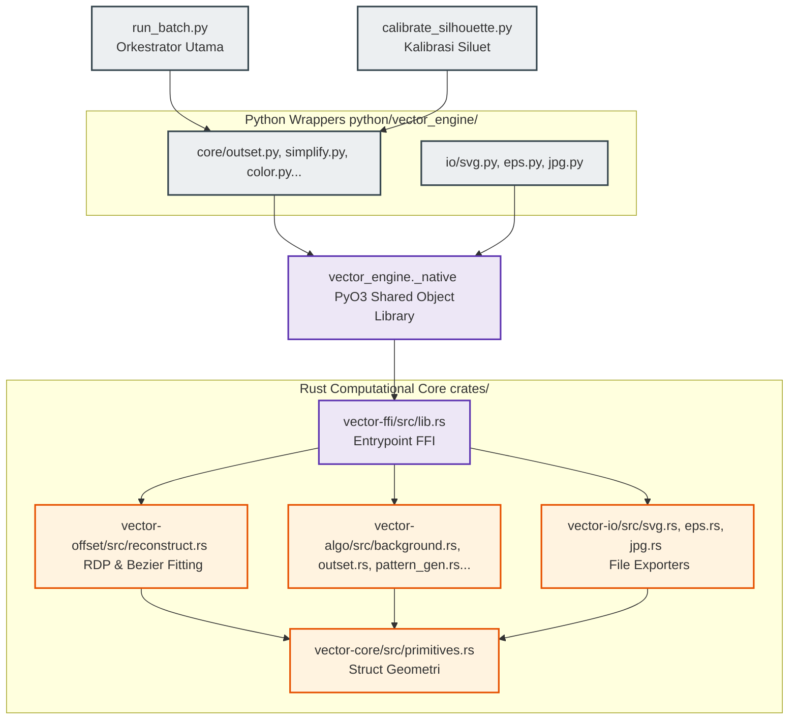

# Diagram & Alur Kerja (Workflow) Sistem Vector Geometry Engine

Dokumen ini menjelaskan pembagian teknologi (**Python 🐍**, **Rust 🦀**, **Hybrid ⚖️**, dan **Fallback/Cadangan ⚠️**) serta memetakan file mana saja yang aktif dan berguna di setiap fase pemrosesan.

---

## 🗺️ 1. Peta Arsitektur File (High-Level Architecture)

Diagram berikut menggambarkan bagaimana file Python (sebagai pengatur/mandor) memanggil modul jembatan PyO3 untuk mengeksekusi perhitungan geometri berat di dalam Core Engine Rust:

---

## ⏱️ 2. Alur Kerja Fase-Demi-Fase (Phase 0 s.d. Phase 7)

Tabel di bawah menjelaskan alur eksekusi saat Anda menjalankan `python run_batch.py`:

| Fase | Nama Fase | Tipe Teknologi | File yang Mengeksekusi (Aktif) | Detail Tugas |
| :---: | :--- | :---: | :--- | :--- |
| **0** | **Initialization** | **Python 🐍** | [run_batch.py](file:///home/panjikali/Projects/vector_engine/run_batch.py) | Membaca argumen CLI, memuat profil JSON, mencari file SVG di folder input. |
| **1** | **Outset & Combine** | **Hybrid ⚖️** | [crates/vector-algo/src/background.rs](file:///home/panjikali/Projects/vector_engine/crates/vector-algo/src/background.rs) [crates/vector-algo/src/color_combine.rs](file:///home/panjikali/Projects/vector_engine/crates/vector-algo/src/color_combine.rs) | Dipicu oleh Python via FFI Rust `process_svg_outset`. Rust mendeteksi/menormalisasi background solid, lalu menyatukan jalur warna yang sama menjadi *compound path*. |
| **2** | **Simplification** | **Rust 🦀** | [crates/vector-offset/src/reconstruct.rs](file:///home/panjikali/Projects/vector_engine/crates/vector-offset/src/reconstruct.rs) | Berjalan otomatis di dalam memori saat Phase 1 di Rust. Melakukan penyederhanaan titik koordinat Ramer-Douglas-Peucker (RDP) dan Cubic Bezier Curve Fitting kustom Rust. |
| **3** | **Color Isolation & Silhouette** | **Hybrid ⚖️** | [crates/vector-algo/src/luminance.rs](file:///home/panjikali/Projects/vector_engine/crates/vector-algo/src/luminance.rs) [crates/vector-algo/src/color.rs](file:///home/panjikali/Projects/vector_engine/crates/vector-algo/src/color.rs) | Dipicu via FFI `apply_silhouette_variant_json`. Melakukan isolasi warna HSL, mereduksi warna mirip, dan menggambar varian siluet / tema warna. |
| **4** | **Bad Board Generation** | **Hybrid ⚖️** | [crates/vector-algo/src/duo_board.rs](file:///home/panjikali/Projects/vector_engine/crates/vector-algo/src/duo_board.rs) | Dipicu via FFI `create_duo_board_json`. Menggabungkan gambar asli dan siluet secara bersisian dengan gap dinamis. |
| **5** | **Seamless Pattern** | **Hybrid ⚖️** | [crates/vector-algo/src/pattern_gen.rs](file:///home/panjikali/Projects/vector_engine/crates/vector-algo/src/pattern_gen.rs) [crates/vector-algo/src/pattern_detect.rs](file:///home/panjikali/Projects/vector_engine/crates/vector-algo/src/pattern_detect.rs) | Dipicu via FFI `generate_pattern_styled_json`. Menyusun motif ubin pattern dengan sub-pixel snapping $0.05\text{ px}$ bebas celah. |
| **6** | **Canvas Auto-Scale** | **Hybrid ⚖️** | [crates/vector-algo/src/scale.rs](file:///home/panjikali/Projects/vector_engine/crates/vector-algo/src/scale.rs) | Dipicu via FFI `scale_document_area_json`. Menskalakan dimensi gambar secara proporsional ke standar target 19 Megapixel. |
| **7** | **Disk Export & JPG Render** | **Hybrid ⚖️** | [crates/vector-io/src/eps.rs](file:///home/panjikali/Projects/vector_engine/crates/vector-io/src/eps.rs) [crates/vector-io/src/jpg.rs](file:///home/panjikali/Projects/vector_engine/crates/vector-io/src/jpg.rs) | Dipicu via FFI `export_batch_deliverables_native`. Rust menulis berkas SVG, menulis EPS kustom, dan merender JPG (via `resvg`) secara paralel menggunakan threadpool Rayon. |

---

## 🗂️ 3. Panduan Fungsi Berkas: Mana yang Berguna & Cadangan?

### A. Berkas Aktif & Sangat Berguna (Core Pipeline)
* **[run_batch.py](file:///home/panjikali/Projects/vector_engine/run_batch.py)**: Berkas pusat yang mengatur antrean dan CLI batch.
* **[crates/vector-ffi/src/lib.rs](file:///home/panjikali/Projects/vector_engine/crates/vector-ffi/src/lib.rs)**: Jembatan PyO3 yang mengekspos semua logika komputasi Rust agar bisa dibaca oleh Python sebagai `vector_engine._native`.
* **[crates/vector-offset/src/lib.rs](file:///home/panjikali/Projects/vector_engine/crates/vector-offset/src/lib.rs)** & **[reconstruct.rs](file:///home/panjikali/Projects/vector_engine/crates/vector-offset/src/reconstruct.rs)**: Menghitung outset geometri dan penyederhanaan kurva RDP (Phase 2).
* **[crates/vector-algo/src/](file:///home/panjikali/Projects/vector_engine/crates/vector-algo/src/)**: Folder berisi algoritma inti: background processor (`background.rs`), penggabung warna (`color_combine.rs`), papan gabungan (`duo_board.rs`), penskalaan kanvas (`scale.rs`), dan perayap pola ubin (`pattern_gen.rs` & `pattern_detect.rs`).
* **[crates/vector-io/src/](file:///home/panjikali/Projects/vector_engine/crates/vector-io/src/)**: Penanganan I/O file fisik: parser SVG (`svg.rs`), konverter Adobe PostScript EPS (`eps.rs`), dan render gambar raster JPEG (`jpg.rs`).
* **[crates/vector-core/src/primitives.rs](file:///home/panjikali/Projects/vector_engine/crates/vector-core/src/primitives.rs)**: Struktur data dasar yang mendefinisikan objek seperti `VectorDocument`, `VectorPath`, `Point2D`, dan `PathCommand`.

### B. Berkas Wrapper Python (Penyederhana Sintaks)
Berkas di bawah folder `python/vector_engine/core/` dan `io/` adalah **Wrapper**. Berkas ini berguna untuk membungkus pemanggilan FFI Rust yang rumit agar menjadi fungsi Python yang bersih.
* Contoh: `python/vector_engine/core/outset.py` membungkus fungsi FFI `apply_outset_json` agar Python dapat memanggilnya dengan sintaks Python standar yang ramah pengguna.

### C. Berkas Cadangan / Fallback (Hanya Aktif Jika Terjadi Error)
Di dalam [run_batch.py](file:///home/panjikali/Projects/vector_engine/run_batch.py), terdapat fungsi cadangan tertulis dalam Python murni:
* **`_render_jpg_via_resvg`** dan **`_render_eps_via_native_rust`**: Menggunakan library Python `resvg_py` dan `PIL` untuk membuat JPG/EPS.
* **Kapan ini aktif?** Hanya jika fungsi ekspor paralel di Rust (`export_batch_deliverables_native`) mengalami error crash. Maka sistem Python akan mengambil alih penulisan file secara perlahan sebagai cadangan agar program tidak berhenti mendadak.

### D. Berkas yang Sudah Dihapus (Pembersihan C++ Legacy)
File C++ Inkscape Livarot berikut **sudah dihapus sepenuhnya** dari proyek sehingga tidak membebani sistem kompilasi Anda:
* ❌ `crates/vector-ffi/src/inkscape_simplify.cpp`
* ❌ `crates/vector-ffi/src/inkscape_simplify.h`
* ❌ `crates/vector-ffi/src/inkscape_bridge.rs`
* ❌ `crates/vector-ffi/build.rs` (Build script C++ compiler).
