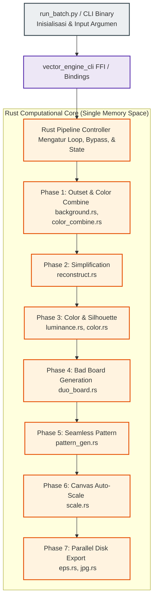

# Diagram & Alur Kerja (Workflow) Konsep Full Rust

Dokumen ini menjelaskan rancangan arsitektur jika sistem dimigrasi penuh untuk berjalan **100% di dalam Rust (Full Rust)**. Pada skenario ini, orkestrasi, pengelolaan status memori, penanganan antrean file, dan logika pengondisian dipindahkan sepenuhnya dari Python ke Rust.

---

## 🗺️ 1. Peta Arsitektur Konsep Full Rust

Pada arsitektur ini, Python hanya bertindak sebagai pemicu opsional atau pembungkus CLI sederhana di bagian awal. Seluruh data geometry (`VectorDocument`) tetap berada di memori Rust dari Phase 1 hingga Phase 7 tanpa perlu ditransfer bolak-balik lewat FFI String JSON:

---

## ⏱️ 2. Alur Kerja Fase-Demi-Fase (100% Rust Execution)

Berikut adalah tabel fase pemrosesan jika berjalan sepenuhnya di bawah kendali Rust:

| Fase | Nama Fase | Tipe Teknologi | Penanggung Jawab Logika | Detail Tugas & Aliran Memori (Zero-Copy) |
| :---: | :--- | :---: | :--- | :--- |
| **0** | **Initialization** | **Rust / Python 🐍** | `cli.rs` / `run_batch.py` | Membaca konfigurasi profil, mencari file SVG input. Menyiapkan parameter awal. |
| **1** | **Outset & Combine** | **Rust 🦀** | `crates/vector-algo/src/color_combine.rs` | **Transform Baking** langsung dibakar ke koordinat absolut. Mendeteksi Badge via `badge_cluster.rs`. Jika badge terdeteksi, set flag bypass langsung di memori Rust. |
| **2** | **Simplification** | **Rust 🦀** | `crates/vector-offset/src/reconstruct.rs` | Penyederhanaan koordinat RDP dan Bezier curve fitting murni Rust (dilewati otomatis jika flag bypass lencana aktif). |
| **3** | **Color Isolation & Silhouette** | **Rust 🦀** | `crates/vector-algo/src/luminance.rs` | Isolasi warna HSL, color merge, dan pembuatan varian siluet (dilewati otomatis jika flag bypass lencana aktif). |
| **4** | **Bad Board Generation** | **Rust 🦀** | `crates/vector-algo/src/duo_board.rs` | Menggabungkan gambar asli dan siluet secara bersisian (dilewati jika flag bypass lencana aktif). |
| **5** | **Seamless Pattern** | **Rust 🦀** | `crates/vector-algo/src/pattern_gen.rs` | Menyusun motif ubin pattern dengan sub-pixel snapping $0.05\text{ px}$ bebas celah (dilewati jika flag bypass lencana aktif). |
| **6** | **Canvas Auto-Scale** | **Rust 🦀** | `crates/vector-algo/src/scale.rs` | Menskalakan dimensi gambar secara proporsional ke standar target area 19 Megapixel. |
| **7** | **Disk Export & JPG Render** | **Rust 🦀** | `crates/vector-io/src/` | Menulis SVG, menulis EPS kustom, dan merender JPG (via `resvg`) secara paralel menggunakan threadpool Rayon langsung dari memori Rust ke Disk. |

---

## ⚖️ 3. Perbandingan Analisis: Hybrid vs Full Rust

| Parameter | Sistem Hybrid (Saat Ini) | Sistem Full Rust (Rencana) |
| :--- | :--- | :--- |
| **Alokasi RAM** | Heap String dialokasikan bolak-balik antara Python & Rust untuk mentransfer SVG setiap akhir fase. | Geometri disimpan di dalam memori Rust (`VectorDocument`) dari awal hingga akhir. **Zero data transfer overhead**. |
| **Kecepatan** | Sedikit terhambat FFI overhead dan GIL Python saat menjalankan loop antrean file paralel. | Maksimal. Threading murni Rust dengan Rayon mengeksekusi antrean file tanpa hambatan GIL. |
| **Kemudahan Debug** | **Sangat Mudah**. Perubahan logika alur, nama file, atau cetakan log terminal bisa diedit instan di Python. | **Sedang-Sulit**. Setiap perubahan logika sekecil apa pun memerlukan kompilasi ulang kode Rust. |
| **Kemudahan Deploy** | Butuh Python 3.10+, Virtual Environment (`.venv`), dan dependensi pip. | **Sangat Praktis**. Hanya membutuhkan satu file biner hasil kompilasi (`vector_engine_cli`). |
